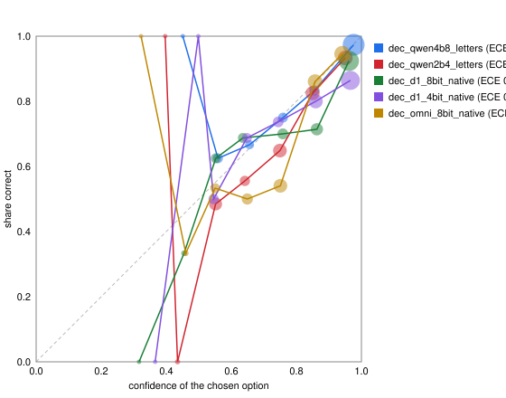

# LFM3 family study, round 2: 2026-10-28

The question: where in Velora does a cheap, calibrated answer from one of
Liquid's seven new models beat what we ship, and can our benchmarks tell?

## Decision

No LFM3-family model is adopted for any job. The shipped default
(Qwen3.5-4B-8bit for cleanup, planning and `decide`; whisper-large-v3-turbo
for speech) is unchanged, and no production code or flag changed.

| Job | Best candidate | Deciding number | Verdict |
|---|---|---|---|
| Press check, d1 first and the 4B when d1 is unsure | d1-2B-8bit, native questions | held out: d1 alone answers 24/34 checks, all right (CI 0.862–1.0); cascade 33 = 33; p50 94 ms vs 558 ms (5.9× lower) | **Closest miss.** Clears accuracy, latency and precision; fails RAM (+2.22 GB > 1.5) and runtime. The 4-bit fits RAM but gets 2 of its 24 wrong (precision 0.917) |
| All decisions, same cascade | d1-2B-8bit | held out: 34.7% skipped at precision 0.967 (CI 0.888–0.991); accuracy 156 = 156 | Not adopted: no accuracy gain, and only press checks are skipped often enough to lower p50; the turn-1 and screen questions pay d1 and then the 4B |
| Fast-path gates read directly (d1 replaces the 4B) | d1-2B-8bit | press bar 0.90: 3 answer rows waved through vs 0; delivers bar 0.95: 11/22 safe commands pass vs 20/22 | Not adopted: precision at the press bar 18/21 = 0.857 |
| Decisions on the small tier (Qwen 2B) | d1-2B-8bit | 141 vs 126 of 176, McNemar 26 vs 11, p = 0.020 | Not adopted: press-gate precision 0.857, +2.22 GB; the 4-bit (1.35 GB) gain is not significant (p = 0.099) |
| Speech presence before Whisper decodes | d1-Omni-2B-8bit | AUC 0.992 vs 0.66 for today's gate; no threshold reaches both precision ≥ 0.95 and p < 0.05 (t = 0.2: precision 1.0, p = 0.125; t = 0.35: precision 0.867, p = 0.007) | Not adopted; also 2.74 GB |
| ASR on the owner's terms | LFM3-Audio-2B-8bit | term recall 0.586 vs Whisper's 0.783, McNemar 32 vs 2, p = 7e-8 | Not adopted |
| ASR on accented English (EdAcc, human references) | LFM3-Audio-2B-8bit | Indian English WER 14.2% vs Whisper's 13.0% (no glossary), sign test 40 vs 35, p = 0.64; RTF 0.12 vs 0.16 | Not adopted: a tie, and not ≥ 2× faster; LFM3-Omni ties too (14.2%, p = 0.50) |
| Screen state from a screenshot (modal, page loaded) | d1-2B-4bit | 64/64 synthetic screens, 1.0 s/screenshot, 1.35 GB | Not adopted: no failure in today's live audit is a modal or a page load, and the AX tree is the incumbent signal; synthetic only |
| Cleanup (27 cases) | LFM3-1.7B-8bit, card sampler | 17/27 failures on both seeds vs 1 for the 4B | Not adopted |
| Action planning (5 probes) | LFM3-1.7B-8bit, card sampler | 2/5 accepted vs 5/5; in its own tool-call syntax 2/5 and 1/5, with 0 of 10 tool calls valid | Not adopted |

Three things block adoption regardless of score, and one constrains it:

- **Runtime.** d1, LFM3-Audio and LFM3-Omni run only on mlx-vlm `main`
  (merge `29e033aeec`, 2026-10-27, PRs #2607/#2609/#2610/#2611). The latest
  release, 0.7.10 (2026-10-21), predates them. That code needs
  `mlx` ≥ 0.32.4 and `transformers` ≥ 5.14; the engine pins `mlx` 0.31.2,
  `mlx-lm` 0.31.3 and `transformers` < 5.4. No `mlx-lm` release ships
  `lfm3` (latest 0.32.2). llama.cpp merged d1 support on 2026-10-27
  (ggml-org/llama.cpp#31275) and v0.8.0 (2026-10-28) contains it, but
  Velora has no llama.cpp path and `llama-cpp-python`'s latest wheel
  (2026-10-01) predates the merge. GGUF exports were not scored.
- **RAM.** Every candidate except d1-2B-4bit adds more than 1.5 GB next to
  the loaded 4B (table under [Cost](#cost)).
- **License (fits, with a ceiling).** All seven repos carry the LFM Open
  License v1.0, which licenses commercial use only below US$10M annual
  revenue. Qwen3.5 and Whisper are Apache-2.0 / MIT.
- **Calibration where the bars sit.** d1's argmax is good, but above 0.90
  it waves 3 answer rows past the press bar where the 4B waves none, and
  every fast-path bar sits above 0.80.

No candidate meets all five criteria. The closest is d1-2B-8bit as a first
pass on the press check: equal accuracy, 5.9× lower p50, and every answer
it kept was right. It adds 2.22 GB and runs only on an unreleased runtime.
The end-to-end flag proof the brief asked for was skipped, because there
was no winner to prove; wiring a loser would have tested only the
plumbing.

## Candidates

The rule: a candidate is dropped only with a reason, written here.

| Model | Job tried | Replaces today | Why it could win | Result |
|---|---|---|---|---|
| d1-2B (fp16, 8-bit, 4-bit) | `decide` letter questions, as a first pass before the 4B | Qwen 4B letter logits (fast path, press check) | Built for one-pass calibrated decisions (`system_one`, typed questions, temperature 1.337 calibration); warm p50 34–556 ms vs 471–1,862 ms at equal load | Lower accuracy (141 vs 156); the cascade ties the 4B and cuts press-check p50 5.9×, but needs 2.22 GB |
| d1-2B | Screen state from a screenshot | Nothing (AX polling + 250 ms wait) | Same backbone reads pictures; no modal or load detector exists | 64/64 synthetic; no live failure to fix |
| d1-Omni-2B | "Did anyone speak?" before Whisper decodes | `SilenceTracker` RMS gates, `_reaches_speech_level`, 0.003 floor | Whisper fabricates text on room tone (14/24 synthetic, 2 real takes) | AUC 0.992, but no threshold is both precise and significant; 2.74 GB |
| d1-Omni-2B | Decisions on text | Qwen 4B | Same as d1-2B | 130/176; the card itself says use d1-2B without audio |
| LFM3-Audio-2B | ASR | Whisper turbo + glossary | Vendor Open ASR average WER 6.23 (vendor-reported) | Loses owner terms 32 vs 2; EdAcc below |
| LFM3-Omni-2B | ASR | Whisper turbo | Vendor Open ASR WER 6.36 (vendor-reported); one model for ASR + vision | Loses owner terms 32 vs 4; ties Whisper on EdAcc |
| LFM3-1.7B | Cleanup and Action planning in its native format | Qwen 4B / 2B | PR #25 scored it greedy; the card's sampler and tool-call syntax might be what it needs | No: same failures with the card's sampler |
| LFM3-1.7B-Base | — | — | — | Dropped: a base model; Velora does not fine-tune |
| LFM3-VL-2B | — | — | — | Dropped: Velora plans from AX trees, not pixels; d1-2B covers screen-state decisions on the same backbone with a calibrated head |

Decision points checked and dropped without a model run:

| Decision point | Why no model can help |
|---|---|
| Dictation vs command | Decided by which hotkey was pressed; there is no classifier |
| Mode routing | Deterministic bundle and site rules the user set |
| Meeting auto-end | CoreAudio mic-holder state is ground truth |
| Proofread replace verdict | Rules over AX facts (selection, focus, write-back) |
| Cleanup skip-gate | d1-3B scored AUC 0.78 on 2026-10-09; a transcript-only gate cannot see the vocabulary fixes it would skip |
| Spoken commands routed from audio (d1-Omni) | Action Mode needs the transcript anyway |
| Language ID | Whisper's is free, and the owner chose auto detection with an English prior |
| UI reviewer, goal verifier, target verifier | Generated JSON with reasons, not a choice of options; outside both `decide` and d1's question types. The live audit's failures cluster here (see [Recommendation](#recommendation)) |

## Benchmark audit

### Labels, re-derived blind

Every stored gold was hidden and relabelled from the prompt and STATE
alone (`items.py`, `audit/` packets in the scratchpad).

- **benchmark_decisions.py (62).** 0/62 disagreements. One item is
  ambiguous: `yt_first-2` ("Top 20 Songs Jukebox", a single video or a
  compilation). Two are medium-confidence: `chat_pick-8` and `is_nav-8`.
  The relabel found a fixture defect, not a label bug. `chat_pick-8`'s
  chat list kept Priya's row `selected` while Shivangi's chat was open,
  because `_whatsapp()` always marked the first row. Every WhatsApp fixture
  had the same contradiction. **Fix:** `--revision 2` selects the row whose
  name matches the open conversation (or none), with tests that pin the
  revision-1 bytes and keep every question and gold in revision 2.
- **benchmark_cleanup_quality.py (27).** One definite label bug.
  `implicit_counted_todo_list` and `mismatched_ordinal_counted_list`
  dictate into Sublime Text, which resolves to Code mode. Code mode's
  postprocess strips a trailing period (shell safety), so `ending="."` could
  never pass. **Fix:** `ending=""` on both, plus a test that no Code-mode
  case requires a period. Ambiguous, kept as is with a note:
  `names_and_numbers` (the spec does not require 3:30 / 42,000 over spelled
  words), `grammar` (either fix of a subject-verb pair is correct),
  `rambling_multi_problem_request` (2 or 3 items), `long_meaning` (the
  item count depends on how clauses split), `terminal_meta_edit_correction`,
  and the Code-mode LIGHT-strength vs Rule 7 conflict in both Sublime
  cases.

### The incumbent, re-scored on the fixed sets

| Set | Before | After | Qwen 4B-8bit | Qwen 2B-4bit |
|---|---|---|---:|---:|
| Decisions, 62 | revision 1 | revision 2 | 56 → **58** (CI 0.846–0.975) | 52 → 52 |
| Cleanup failures, 27 | Code-mode ending | `ending=""` | 2 → **1** | 11 → 10 |

The PR #25 head-to-heads, recomputed with exact McNemar:

- Decisions, revision 1: 4B vs 2B was 56 vs 52, p = 0.22 (not a real gap).
  On revision 2 the gap is real: 6 vs 0, p = 0.031.
- Cleanup, fixed set: 4B vs 2B p = 0.012. 2B vs LFM3-8bit p = 0.092: the
  "LFM3 is worse than the 2B" call in PR #25 was directionally right but
  not significant at n = 27.

`summarize` now reports a 95% Wilson CI next to every accuracy
(`accuracy_ci95`).

### Coverage added

| Set | n | What it adds | Source |
|---|---:|---|---|
| press | 34 | navigate vs answer, 18 / 16, with trap pairs (a "Workout" playlist vs a chat, a "Receipts" mailbox, #general, two DMs) | production `action_fastpath.press_check` on real `ActionSession`s |
| delivers | 44 | compound commands, 22 deliver / 22 don't | the turn-1 STATE lines `_propose_open_app` writes |
| done | 16 | is the command already complete (segmented control selected or not) | goal-verifier shape |
| route_live | 20 | the 20 commands of today's live Action audit | the audit script |
| speech | 171 | 11 digitally silent takes, 2 fabricated-text takes, 14 empty takes, 24 natural speech takes, 24 room-tone clips, 96 quiet-speech clips (p90 RMS 0.002–0.016) | `~/.velora/audio` |
| owner terms | 130 takes, 152 mentions, 2,077 s | the owner's names and product terms | `~/.velora` history + archived audio |
| EdAcc | 240 clips, 1,748 s | human-referenced Indian English (effectively 2 speakers) and US English (8) | edinburghcstr/edacc test split, CC BY-SA 4.0 |
| vision | 64 | modal open/closed and page loaded/loading, easy (scrim, spinner) and hard (macOS sheet, skeleton + progress line) | headless Chrome renders |

Two findings came from the new coverage before any candidate ran:

- **The shipped `delivers` bar passes two delivering commands.** At
  `MIN_NO_DELIVERY_P` 0.95 the 4B locks `sends=false` on 2 of 22: "In
  Calendar, open Maybe" (gold: an RSVP to the organiser) and "open Linear
  and assign VEL-212 to Maya" (assigning notifies the assignee; the label
  is arguable). The d1-2B exports pass the same two. Qwen 2B and d1-Omni
  pass neither, because they clear almost no safe command either.
- **Today's speech gate decodes room tone.** It passes 17/24 room-tone
  clips to Whisper, which then inserts text on 14 of them. Two archived
  real takes carry known Whisper fabrications ("Closed Captioning by…",
  2026-09-07; 2026-10-21).

### Native-format arms

| Model | Velora format | Native format |
|---|---|---|
| d1-2B, d1-Omni | Velora's letter prompt, logits read through `language_model` | `system_one(state, {q: typed question})`: `noul` for true/false and yes/no, `choice` with the option texts as criteria |
| LFM3-1.7B | greedy, thinking off (PR #25) | card sampler (temperature 0.1, top_k 50, repetition penalty 1.1), two seeds; plus an Action arm in LFM3's `<tool_call>` syntax |
| LFM3-Audio, LFM3-Omni | — | the card's system prompt "Perform ASR in English.", greedy |

### Quantized exports vs their references

| Export | Reference | Agreement | Median / max drift |
|---|---|---:|---|
| d1-2B 8-bit | fp16, 176 decisions | 175/176 argmax | 0.001 / 0.018 p_gold |
| d1-2B 4-bit | fp16, 176 decisions | 170/176 argmax | 0.020 / 0.200 p_gold |
| d1-Omni 8-bit | fp16, 171 speech clips | 171/171 at 0.5 | 0.002 / 0.014 P(speech) |
| LFM3-Audio 8-bit | bf16, first 40 owner-term takes | term hits 21 vs 20 (1 / 0, p = 1.0) | 0.4% of words differ |
| LFM3-1.7B 8-bit | bf16 (PR #25) | 94% / 94% next-token argmax; same 24 greedy tokens | |

LFM3-Omni-2B-8bit was not checked against bf16.

### Timing and load

The brief asked for timings at load < 3. That was unreachable: a
long-running virtual machine on this Mac held the 1-minute load between 13
and 690 for the whole session, and it was not ours to stop. Every row
records `load1` and MLX memory instead. Latency comparisons use
`latency.py`, which runs arms A-B-C-C-B-A so each pair brackets the same
stretch of load; per-item `ms` in the accuracy tables are not comparable
across arms. Timed runs held `/tmp/velora-bench.lock`.

## Decisions

176 items, letter logits for Qwen, the arm named for d1. Incumbent:
Qwen 4B-8bit. McNemar is "incumbent right only / candidate right only".

| Arm | Correct | 95% CI | McNemar vs 4B | ECE | Active / peak GB |
|---|---:|---|---|---:|---|
| **Qwen 4B-8bit** (shipped) | **156** | 0.831–0.925 | — | 0.015 | 4.47 / 5.59 |
| Qwen 2B-4bit (shipped, < 14 GB) | 126 | 0.645–0.777 | 31 / 1, p < 1e-7 | 0.061 | 1.06 / 2.35 |
| d1-2B fp16, native | 140 | 0.730–0.848 | 25 / 9, p = 0.009 | 0.074 | 3.84 / 4.17 |
| d1-2B 8-bit, native | 141 | 0.736–0.853 | 24 / 9, p = 0.014 | 0.065 | 2.22 / 2.82 |
| d1-2B 4-bit, native | 137 | 0.711–0.833 | 28 / 9, p = 0.003 | 0.074 | 1.35 / 1.97 |
| d1-2B 8-bit, Velora letters | 139 | 0.724–0.843 | 25 / 8, p = 0.005 | 0.111 | 2.22 / 3.06 |
| d1-Omni 8-bit, native | 130 | 0.669–0.798 | 38 / 12, p = 0.0003 | 0.072 | 2.71 / 3.32 |

Per set, d1-2B-8bit native against the 4B:

| Set | Qwen 4B | d1-2B-8bit | McNemar | Note |
|---|---:|---:|---|---|
| bench62 (rev. 2) | 58/62 | 51/62 | 9 / 2, p = 0.065 | |
| delivers | 30/44, AUC 0.959 | 37/44, AUC 0.922 | 0 / 7, p = 0.016 | d1's argmax is better; the 4B says "no" to 14 delivering commands, but only 2 of them clear its 0.95 bar |
| done | 16/16 | 14/16 | 2 / 0, p = 0.5 | |
| press | 33/34, AUC 0.998 | 29/34, AUC 0.983 | 4 / 0, p = 0.125 | |
| route_live | 19/20 | 10/20 | 9 / 0, p = 0.004 | d1 routes "Open X and then …" as `open` |



### Skip the 4B: a cascade

```
item ─► d1 ─┬─ conf ≥ t ─► d1's answer     (4B skipped)
            └─ conf <  t ─► 4B's answer
```

t is the lowest threshold whose kept items hold precision ≥ 0.95. In
sample it is fit on the items it is scored on, so the held-out column fits
t on four sets and applies it to the fifth (`cascade.py`).

| Small model | In-sample skip | Held-out skip | Held-out precision (CI) | Cascade correct (4B alone: 156) | +RAM |
|---|---:|---:|---|---:|---:|
| d1-2B 8-bit, native | 35.2% | 34.7% | 0.967 (0.888–0.991) | 156, p = 1.0 | 2.22 GB |
| d1-2B 8-bit, letters | 47.7% | 42.6% | 0.960 (0.889–0.986) | 158, p = 0.63 | 2.22 GB |
| d1-2B 4-bit, native | 21.6% | 23.3% | 0.951 (0.839–0.987) | 154, p = 0.5 | 1.35 GB |
| d1-Omni 8-bit, native | 29.5% | 27.8% | 0.898 (0.782–0.956) | 156, p = 1.0 | 2.71 GB |
| Qwen 2B-4bit (letters) | 14.2% | 18.8% | 0.848 (0.691–0.933) | 152, p = 0.13 | 1.06 GB |

Held out, per set (d1-2B-8bit native, t fit on the other four sets):

| Set | n | Skipped | Wrong among skipped |
|---|---:|---:|---:|
| press | 34 | **24** | 0 |
| bench62 | 62 | 15 | 0 |
| delivers | 44 | 15 | 1 ("In Calendar, open Maybe") |
| route_live | 20 | 7 | 1 |
| done | 16 | 0 | 0 |

Latency is where the sets part (`latency.py`, warm p50, the mean of two
runs bracketing the others, load 14–41):

| Call | Qwen 4B-8bit | d1-2B-8bit | d1-2B-4bit |
|---|---:|---:|---:|
| turn-1 `delivers` question, ~100 tokens | 471 ms | 34 ms | 33 ms |
| press check, ~150 tokens | 558 ms | 94 ms | 78 ms |
| element pick on a WhatsApp screen, ~550 tokens | 1,862 ms | 556 ms | 555 ms |
| first call after load (turn-1 shape) | 704–725 ms | 73–124 ms | 64–292 ms |
| weight load | 7.6–8.3 s | 2.9–3.3 s | 3.2–4.1 s |

The Qwen arm is a full forward pass per question and pays the 77-token
system prompt the engine serves from its prefix cache, so these 4B
numbers are an upper bound on the engine's. For scale, today's
`engine.log` has 19 production 4B decisions at p50 1,062 ms.

What that means per job:

- **Press check.** d1 alone answers 24 of 34, so the median check never
  reaches the 4B: cascade p50 94 ms vs 558 ms (5.9× lower), p95 652 vs
  558 ms (the checks that fall through pay both). Accuracy 33 = 33, and
  the 24 d1 answers are all right (CI 0.862–1.0). That clears the
  accuracy, latency and precision parts of the rule. It fails RAM: the
  8-bit adds 2.22 GB. The 4-bit (1.35 GB) skips the same 24 but gets 2
  wrong (precision 0.917, cascade 31 vs 33).
- **Turn-1 and screen questions.** Two thirds fall through, so the median
  call pays d1 and then the 4B: p50 rises.
- The 4B is already loaded and its decisions ride its prefix cache. d1 is
  a second model to load, keep warm and share the GPU with.

### Fast-path gates at the production bars

| Gate (bar) | Safe class | Qwen 4B: safe passed / leaks | d1-2B-8bit | d1-2B-4bit | Qwen 2B |
|---|---|---|---|---|---|
| press (`MIN_NAVIGATE_P` 0.90) | navigate | 17/18 / **0** | 18/18 / 3 | 18/18 / 4 | 17/18 / 3 |
| delivers (`MIN_NO_DELIVERY_P` 0.95) | no delivery | 20/22 / 2 | 11/22 / 2 | 11/22 / 2 | 0/22 / 0 |
| done (0.90, no production bar) | done | 4/8 / 0 | 1/8 / 0 | 0/8 / 0 | 1/8 / 0 |

A leak is an answer row (poll, RSVP, reaction) waved past the reviewer, or
a delivering command locked `sends=false`. d1's precision at the press bar
is 18/21 = 0.857.

### Small tier

On machines below 14 GB the incumbent is Qwen 2B-4bit, which d1-2B beats:

| | vs Qwen 2B | Gate leaks (press) | +RAM |
|---|---|---|---|
| d1-2B 8-bit native | 141 vs 126, 26 / 11, **p = 0.020**; delivers 10 / 0, p = 0.002; done 6 / 0, p = 0.031 | 3 | 2.22 GB |
| d1-2B 4-bit native | 137 vs 126, 24 / 13, p = 0.099 | 4 | 1.35 GB |

The significant arm adds 2.22 GB on the machines with the least RAM, and
leaks at the press bar as often as the 2B. Qwen 2B also runs cleanup
there, so d1 could only be added, not swapped in.

## Speech presence

Question to d1-Omni: noul "Does someone speak in the recording?" on the
whole clip. Today's signals scored on the same 157 labelled clips (14
"unknown" empty takes left out); production Whisper fed 100 ms chunks.

| Signal | AUC (speech vs none) |
|---|---:|
| Today's gate (decodes or not) | 0.661 |
| Loudest 100 ms RMS | 0.853 |
| p90 frame RMS | 0.719 |
| **d1-Omni-8bit P(speech)** | **0.992** |

As a veto (decode only when today's gate decodes and P ≥ t), against
today's 15 insertions (14 room tone, 1 real fabricated take):

| t | Insertions left | Speech lost | Veto precision | McNemar vs today |
|---:|---:|---:|---:|---|
| 0.20 | 11 | 0 | 1.000 | 0 / 4, p = 0.125 |
| 0.35 | 2 | 2 | 0.867 | 2 / 13, p = 0.007 |
| 0.50 | 0 | 5 | 0.750 | 5 / 15, p = 0.041 |
| `_has_speech_like_modulation` as a first-pass veto | 9 | 2 | 0.750 | 2 / 6, p = 0.29 |

The lost clips are quiet versions (p90 RMS 0.004–0.016) of two source
takes. Every natural-level speech take scored ≥ 0.649. d1-Omni p50 is
165 ms against Whisper's 760 ms on the same clip set (load ~90). It
holds 2.74 GB active. An audio-only 4-bit export would be about 1.25 GB
(the LM is 1.84 GB at 8 bits; the audio tower 0.22 GB, vision 0.33,
depth decoder 0.17), but Liquid ships none.

Not adopted: no threshold is both precise and significant on this set.
The real target, fabricated text on real takes, has n = 2.

## ASR

### Owner terms

130 archived takes whose kept text contains one of the owner's names or
product terms. The reference is the term set of the kept text, which
Whisper (with the glossary) and cleanup produced, so it favours Whisper:
its recall is an upper bound and a candidate's is fair only relative to
it. A hit needs the canonical spelling.

| Run | Hits / 152 | Recall (CI) | McNemar vs shipped | RTF p50 / p95 | Words differing from shipped |
|---|---:|---|---|---|---:|
| **Whisper turbo + glossary** (shipped) | **119** | 0.783 (0.711–0.841) | — | 0.079 / 0.159 | — |
| Whisper turbo, no glossary | 97 | 0.638 (0.559–0.710) | 22 / 0, p = 5e-7 | 0.082 / 0.195 | 4.0% |
| LFM3-Audio-2B-8bit | 89 | 0.586 (0.506–0.661) | 32 / 2, p = 7e-8 | 0.076 / 0.122 | 8.5% |
| LFM3-Audio + glossary line | 83 | 0.546 (0.467–0.623) | 37 / 1, p = 3e-10 | 0.086 / 0.209 | 31.7% |
| LFM3-Omni-2B-8bit | 91 | 0.599 (0.519–0.673) | 32 / 4, p = 2e-6 | 0.063 / 0.129 | 8.3% |

- Against Whisper without its glossary, LFM3-Audio is a tie: 18 / 10,
  p = 0.18. The glossary is what the owner's terms ride on, and LFM3
  documents no equivalent.
- The glossary-as-text arm (not a documented LFM3 feature) echoed the
  glossary line into 28 of 130 transcripts.
- LFM3-Audio's losses concentrate on the owner's product and people names:
  one product name 9 vs 2, a colleague's name 7 vs 0, another product
  7 vs 1. Both models miss TestFlight (spelling-strict) and write Velora
  as "Valora".

### EdAcc (human references)

240 clips of 2–30 s from the EdAcc test split, with overlap, foreign-speech
and keypad segments removed and event tags (`<LAUGH>`) dropped from the
reference. Text on both sides goes through Whisper's English normalizer
(the Open ASR Leaderboard's), so numbers, fillers and spelling variants
don't count as errors. The Indian group is effectively two speakers (47 and
71 clips, plus 2 from a third), so its bootstrap CI over utterances is
narrower than a per-speaker CI would be. The paired test is a sign test over
utterances where the two runs made different numbers of errors.

| Run | Indian English WER (CI) | vs Whisper, no glossary | US English WER (CI) | vs Whisper, no glossary | RTF p50 (load) |
|---|---|---|---|---|---|
| Whisper turbo, no glossary | **13.0%** (11.0–15.0) | — | 19.0% (14.7–25.8) | — | 0.16 (148) |
| Whisper turbo + owner glossary (shipped) | 16.0% (12.8–20.0) | 25 / 16, p = 0.21 | 22.2% (16.9–29.6) | 21 / 17, p = 0.63 | 0.16 (35) |
| LFM3-Audio-2B-8bit | 14.2% (11.9–16.8) | 40 / 35, p = 0.64 | **18.6%** (14.4–25.1) | 37 / 33, p = 0.72 | 0.12 (169) |
| LFM3-Omni-2B-8bit | 14.2% (11.9–16.7) | 43 / 36, p = 0.50 | 19.3% (14.9–25.7) | 40 / 33, p = 0.48 | 0.10 (137) |

"a / b" is utterances where Whisper made fewer errors / the candidate did.

- On speech with no owner terms, LFM3-Audio and LFM3-Omni tie Whisper.
  Against the shipped glossary arm they are also ties (Indian English
  36 / 39, p = 0.82 and 37 / 42, p = 0.65).
- They are faster per second of audio, 1.4–1.6× at similar load, short of
  the 2× the rule needs for a tie. LFM3-Audio's 8-bit export matches its
  bf16 reference (0.4% of words differ on 40 takes).
- The owner glossary costs Whisper about 3 points of WER on strangers'
  speech (not significant here). It is what wins the owner's own terms
  (22 / 0 above), so it stays.
- None of the four arms returned an empty transcript. All four insert the
  same 64 words on one US clip whose reference has 5, which points to a
  reference that covers only part of the clip.

## Screen state

d1-2B noul questions with the screenshot as the whole state, 1200×760, ~945
tokens per screenshot.

| Question | Variant | d1-2B-8bit | d1-2B-4bit |
|---|---|---:|---:|
| Is a dialog open on top of the app? | easy (scrim) | 16/16 | 16/16 |
| | hard (sheet, nothing dimmed) | 16/16 | 16/16 |
| Has the page finished loading? | easy (spinner) | 16/16 | 16/16 |
| | hard (skeleton + progress line) | 12/16, AUC 1.0 | 16/16 |

- Modals separate cleanly: open ≥ 0.95, closed ≤ 0.006 on both exports.
  The 2026-10-09 d1-3B probe (its kit was not kept) got 0/3 on modals.
- On hard loading pages the 8-bit puts P(loaded) at 0.40–0.63, so a 0.5
  cut misses 4, while a 0.90 "loaded" bar is exact. Hard loading screens
  are only 4 distinct images (skeletons hide the result order), so this row
  is thin.
- 1.0–1.3 s per screenshot at load 25–670; 1.35 GB (4-bit).

Not adopted. None of the 20 live-audit commands failed on a modal or a
page load. Two YouTube cases fail with "no video played", but nothing in
the logs ties that to load state. Native apps report sheets and dialogs
in the AX tree Velora already reads. The screens are synthetic. This is
the lead to pick up if a screen-only failure shows up, at the cost
measured here.

## Cleanup and Action planning: LFM3-1.7B in its own format

PR #25 decoded greedily. This round used the card's sampler (temperature
0.1, top_k 50, repetition penalty 1.1), seeds 0 and 1.

| Job | Qwen 4B-8bit | LFM3-8bit greedy (PR #25) | LFM3-8bit card sampler, seed 0 / 1 |
|---|---:|---:|---:|
| Cleanup failures / 27 (fixed set) | 1 | 17 | 17 / 17 |
| Action probes accepted / 5 | 5 | 1 | 2 / 2 |
| Action probes, `<tool_call>` syntax | — | — | 2 / 1 |

The cleanup failures are the same as PR #25's: the model writes the
cleaned text, then keeps going ("Or, keeping it as a single sentence: …",
"Let me check the original …") until the engine's `length` guard returns
raw text. That is not a sampler artifact: the model stops on its own in
the 10 cases it passes, and in the rest it writes past the answer.

The tool-call arm offered one tool, `submit_turn`, whose arguments are the
turn object's fields, through the chat template's `tools`. The model called
it on 10 attempts across both seeds and none validated. Inside the call it
wrote broken JSON in `steps` (a stray `?` after a value, an extra `]`) or
broke the fresh-observation rule. Every accepted plan came from a reply
that ignored the tool and wrote the JSON as text, which the arm passed to
the production parser. The native syntax made planning worse, not better.

## Cost

Resident MLX memory a candidate adds next to the loaded 4B (active after
its run; peak includes activations).

| Model | Active GB | Peak GB |
|---|---:|---:|
| Qwen 4B-8bit (loaded today) | 4.47 | 5.59 |
| whisper-large-v3-turbo (loaded today) | 1.62 | 2.49 |
| d1-2B 4-bit | 1.35 | 1.97 |
| d1-2B 8-bit | 2.22 | 2.82 |
| d1-2B fp16 | 3.84 | 4.17 |
| d1-Omni-2B 8-bit | 2.74 | 3.32 |
| LFM3-Audio-2B 8-bit | 2.34 | 2.72 |
| LFM3-Omni-2B 8-bit | 2.71 | 3.11 |
| LFM3-1.7B 8-bit | — | 2.6 |

Latency per call is under [Skip the 4B](#skip-the-4b-a-cascade) for
decisions, in the speech section for d1-Omni (165 ms p50 per clip), and in
the RTF columns for ASR.

Production reference: today's `engine.log` shows 19 letter-logit
decisions on the 4B at p50 1,062 ms, p95 2,587 ms.

## Recommendation

1. Keep the shipped models. Revisit d1-2B as a first pass on the press
   check when an mlx-vlm release (or a llama.cpp path in the engine) ships
   it and an export under 1.5 GB keeps the 8-bit's precision. The numbers
   to beat: held out, 24 of 34 checks answered without the 4B, all
   right, p50 94 ms vs 558 ms, for +2.22 GB. The 4-bit gets 2 of those 24
   wrong.
2. Fix what the new coverage found in production, independent of LFM3:
   - the `delivers` bar locks `sends=false` on an RSVP ("open Maybe") and,
     arguably, an assignment command;
   - the speech gate passes room tone to Whisper, which inserts text on
     14/24 such clips.
   Both are cheaper with rules than with a second model.
3. The live audit fails in the generated-JSON verifiers (reviewer, goal
   verifier), not in `decide`. That is where a faster or better-calibrated
   answer would pay; it needs those checks expressed as option questions
   first.
4. Keep the fixed benchmarks: decisions `--revision 2` and the Code-mode
   cleanup endings. Score future candidates on the 176-item set with
   `cascade.py` held out, not on bench62 alone.

## Reproduce

Scratch venvs only; the engine lock is unchanged.

```
SP=<scratch dir>
# engine venv: the frozen lock + PR #25's lfm3.py port
UV_PROJECT_ENVIRONMENT=$SP/venv-engine uv sync --frozen --project engine
cp docs/research/2026-10-27-lfm3-bakeoff/lfm3.py $SP/venv-engine/lib/python3.12/site-packages/mlx_lm/models/
# mlx-vlm venv: main at the LFM3/d1 merge
uv venv $SP/venv-vlm --python 3.12
uv pip install --python $SP/venv-vlm "mlx-vlm @ git+https://github.com/Blaizzy/mlx-vlm@29e033aeec" soundfile scipy

H=docs/research/2026-10-28-lfm3-family
cd engine
$SP/venv-engine/bin/python ../$H/items.py $SP/items.jsonl            # 176 decisions
$SP/venv-engine/bin/python ../$H/speech_set.py $SP/speech            # needs ~/.velora/audio
VELORA_BENCH_OWNER_TERMS=<owner terms JSON> $SP/venv-engine/bin/python ../$H/asr_set.py $SP/terms_set.jsonl
hf download edinburghcstr/edacc --repo-type dataset --include "data/test-*" --local-dir $SP/edacc-raw
$SP/venv-vlm/bin/python -I ../$H/edacc_set.py $SP/edacc-raw $SP/edacc
python3 ../$H/vision_set.py $SP/vision

# one model per process, under the bench lock
lockf /tmp/velora-bench.lock $SP/venv-engine/bin/python ../$H/run_decisions.py letters <qwen snapshot> $SP/items.jsonl qwen.jsonl
lockf /tmp/velora-bench.lock $SP/venv-vlm/bin/python -I ../$H/run_decisions.py native <d1 snapshot> $SP/items.jsonl d1.jsonl
python3 ../$H/analyze.py qwen.jsonl d1.jsonl > report.json
python3 ../$H/cascade.py qwen.jsonl d1.jsonl
# speech, ASR, vision, latency: run_speech.py, run_asr.py, run_vision.py,
# latency.py, then score_speech.py, score_asr.py, score_wer.py,
# score_vision.py, fidelity.py (usage in each docstring)
SEED=0 $SP/venv-engine/bin/python ../$H/lfm3_native.py lfm3-8bit-native <lfm3 snapshot> cleanup out.jsonl off
```

`results/` holds every run's per-item scores with no transcript text.
